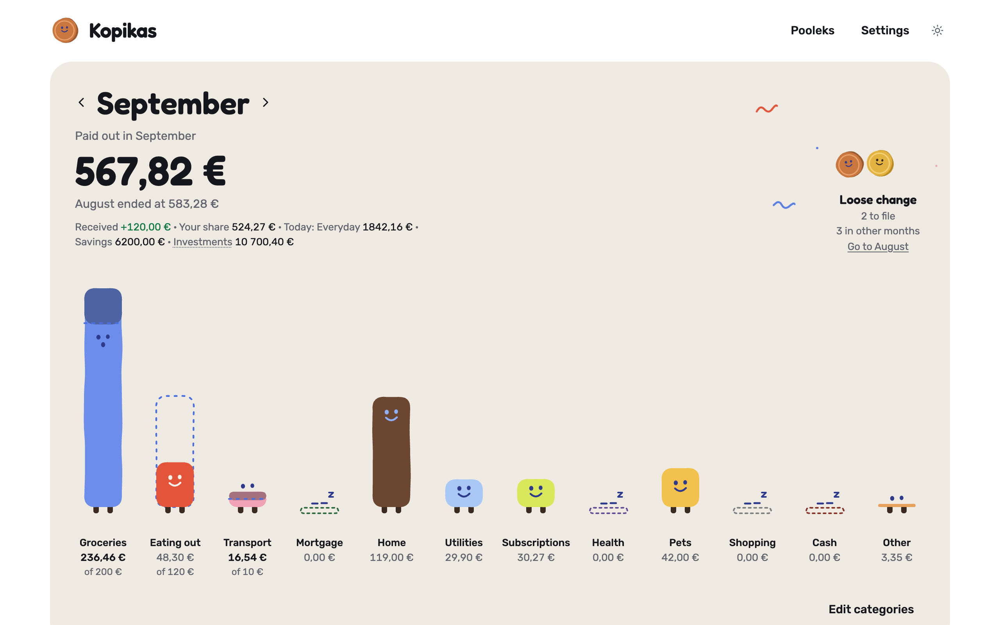
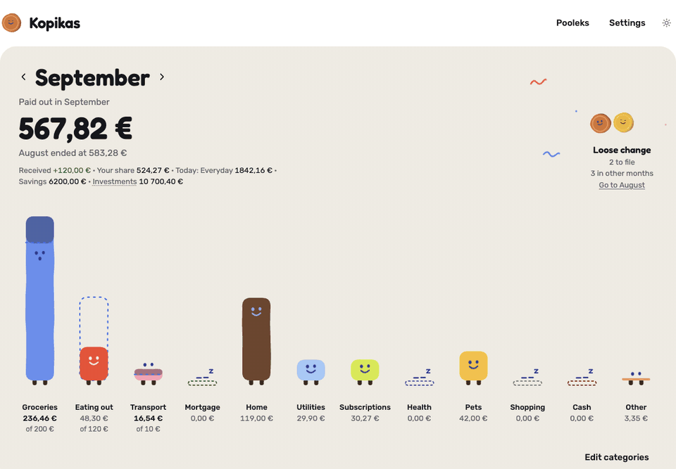
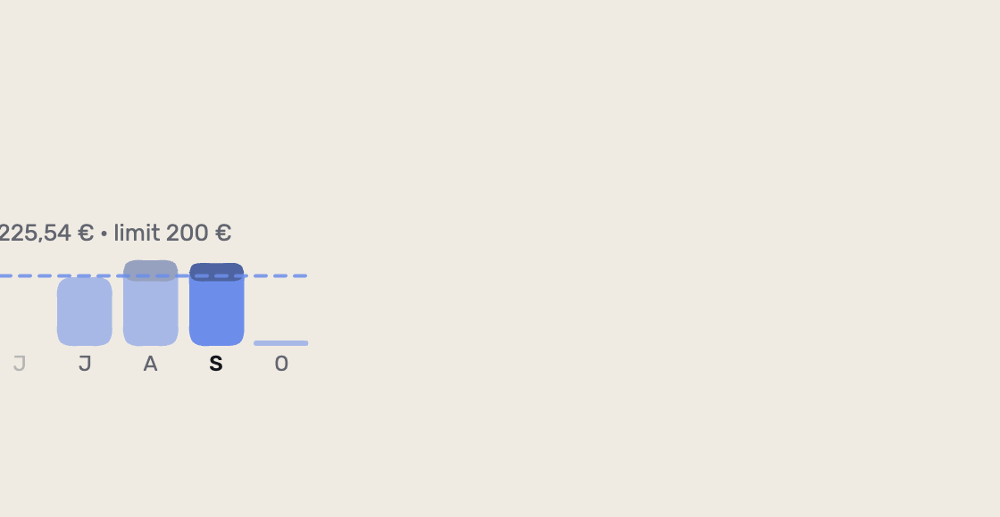
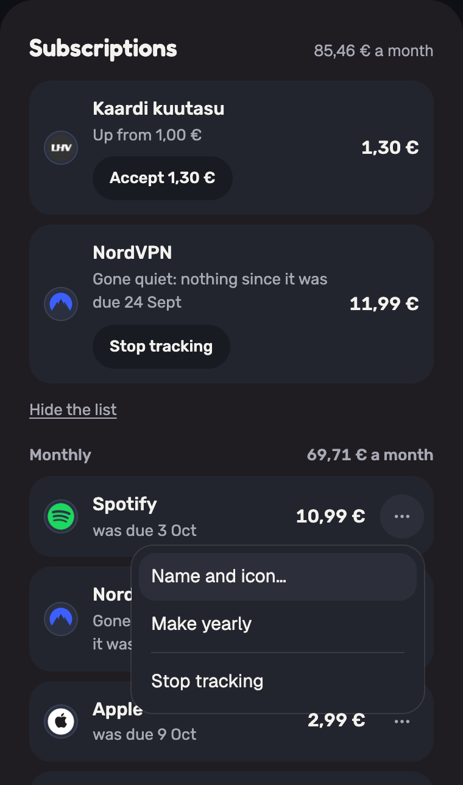
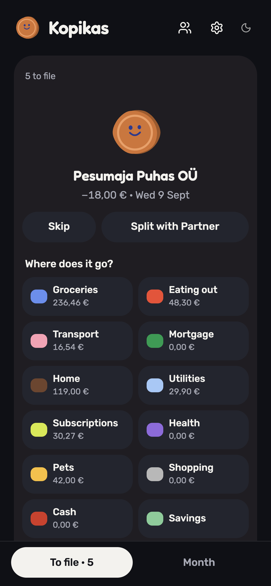
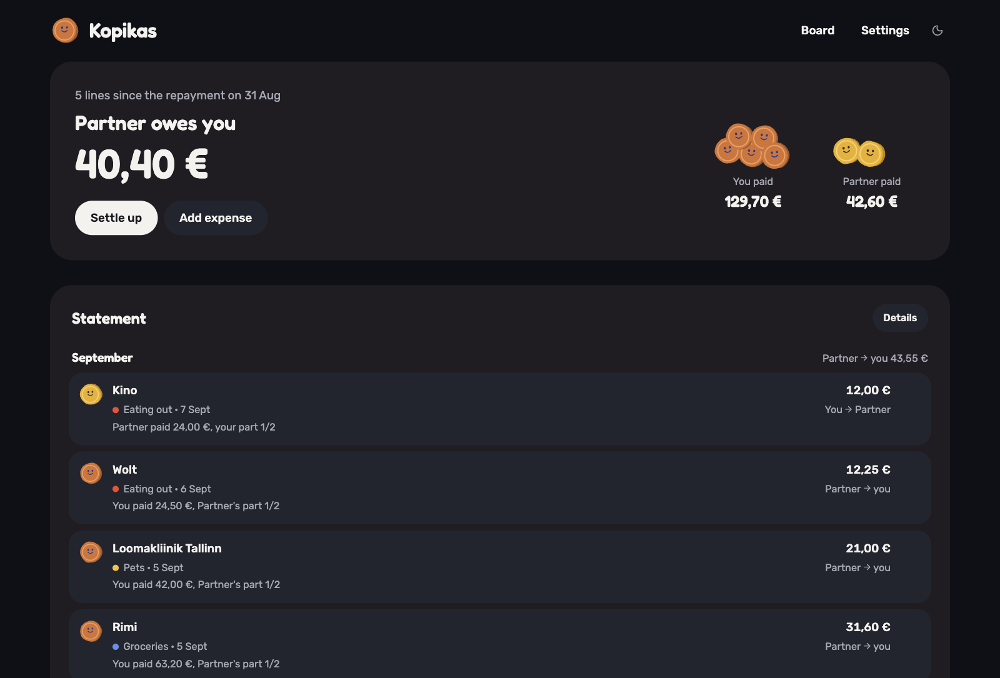

# Kopikas

A personal money board fed by LHV bank data. Every charge arrives as a coin, and you file it into a roll. Named after the humble coin: *iga kopikas loeb*, every penny counts.

<picture>
  <source media="(prefers-color-scheme: dark)" srcset="docs/board-dark.png">
  
</picture>

## Why

Bank apps are built for a phone: tiny numbers, one transaction at a time, no way to see a month at once. Kopikas wants the month as one picture. Every category is a roll with a face that grows as charges go in, all on one shared scale, and categorising becomes a small physical act: drop a coin in a roll, tick *always*, and every past and future charge from that merchant files itself. Two thousand transactions sort themselves in an afternoon.

It is built for one household. Two people sign in, one owns the board and the other sees the shared page. There is no multi-tenant anything.

## What is on the board

The month is the tray at the top. Every category is a roll on one floor, as tall as what went into it that month on a shared scale, so the shape of the month shows before you read a number; every amount is still written under its roll. A roll with nothing in it sleeps, a short one shows only its eyes, a grown one its whole face. Give a category a monthly limit and its roll stands in a dashed outline the limit's height, a jar it is filling; past the limit, the part above the line turns a shade darker. Above the floor, arrows step through the months, and Paid out is everything that left the account that month except savings, shared costs at full price. The line under it says what came in, your share in a month with splits, the account balances and the investments. The LHV investment account is read from the API on every sync, one snapshot a day refreshed through the day; the Lightyear pot has no API and is entered by hand. Under the wordmark, the board says when it last heard from LHV; past 26 hours that line turns into a warning that links to Settings.

Charges not filed yet are the loose change, a small pile of coins in the corner of the tray. Pick one up and tap a roll, and it hops in; the roll gulps and grows. The notice that follows offers *Always*, which writes a rule: a lowercase substring matched against the counterparty and description, so every past and future charge from that merchant files itself. Rules are listed on the Settings page, grouped by the category they file into, with the ones that match nothing gathered first. The tray shows one month at a time; coins from other months wait in their own, and a line under the pile takes you there.



Tap a roll and the board looks at that category: the other rolls fade, the list below shows its charges, and the line under the total becomes its last twelve months, a bar a month drawn like the rolls, with the average and the limit. Click a bar to go to that month. The current view lives in the URL (`?cat`, `?month`, `?q`), so a category in a given month is a link you can keep.



Below the tray, Every charge lists the month newest first, with the merchant's real name and favicon instead of the bank's shouting string. Card payments are one line. Transfers keep their payment note. Search looks through every month and matches the names you see, not only the bank's strings, and Money in shows what came in and from whom. A row's category is a button: it opens a menu with every category, the split with the partner, and the merchant's name and icon, so everything a drag can do works from the keyboard too. On a big screen a row can also be dragged straight onto a roll. Click a merchant's icon to give it your own name, a website for its favicon, or an emoji; it applies to every charge from that merchant.

Categories start as a default list, and Edit categories under the tray renames them, adds new ones, drags them into a new order and sets their limits; a rename carries every rule and filed charge along.

Subscriptions watches recurring charges. File a charge in the Subscriptions roll and the board records the merchant pattern and expected amount, then tracks the last charge, the next due date, and whether the price moved. The card beside the list shows only what needs you, a new price to accept, one gone quiet, one due within a week, and what they all cost a month, the yearly ones spread over twelve. The full list opens in place, monthly and yearly apart. The guess between the two reads the statement text when there is only one charge to go on and re-measures itself once a second charge lands; each row's menu corrects it for good, renames the subscription or stops tracking it.

<p>
  
  
</p>

Pooleks (Estonian for *in half*) is the shared ledger. Split a charge from its row's menu, at 1/2, 1/3 or 1/4, and it becomes a line on a running statement of who owes whom; the Pooleks card beside the list says where the balance stands. On the Pooleks page itself, the head says it too, and shows what each of you has paid since the last repayment as two piles of coins, yours copper and the other's brass; every line wears its payer's coin. Each line shows its amount and an arrow: who owes whom for a shared cost, who paid whom for a repayment. Choose Always and every future charge from that merchant lands on the statement by itself at the same split; past charges are left alone, and the rule can be removed on Settings. The partner signs in and sees the same statement with the labels flipped, plus a way to add what they paid for: on a phone, a message box at the foot of the screen. Either of you records a repayment with Settle up, which shows what the amount would leave open before it is recorded; either can remove one, and new ones say who recorded them. Everything before the latest repayment folds into one line, so the statement shows what is open. This is what replaced Splitwise here: the rows come from the bank, so nothing is typed twice.



Most one-click changes can be taken back: filing a charge, tracking a subscription, splitting a charge or taking it off Pooleks, forgetting a rule, stopping a subscription, accepting a new price, recording or removing a repayment. A notice offers Undo for a few seconds, and ⌘Z or Ctrl+Z does the same. When a change fails, the page says why instead of pretending it worked.

On a phone the board is two tabs at the foot of the screen. To file is the backlog from every month, one coin at a time: the merchant, the amount and the day, Skip and Split under it, and every category as a large tile with what it already holds that month. Tap one and the next coin comes up where your thumb is. Month is the tray, its rolls lying down as bars, with the charges and the cards below. Filing a backlog is the phone's job; seeing the month at once is still the big screen's.

## How it is built

Next.js 16 on the App Router, React 19, TypeScript, Tailwind v4, shadcn/ui on Base UI. The tray is SVG drawn in code: every roll, coin and face is a path whose edges are nudged in long, seeded waves, so it looks cut by hand yet keeps its shape from one render to the next, and Motion springs the hops, the gulps and the growing. Drag and drop is dnd-kit, for the mouse; the keyboard files through a Base UI menu, and a finger through the phone's queue. An action's reply carries the fresh board, so a change is one request. Sign-in is Clerk. Production runs on Vercel with Postgres on Neon.

One storage module, `lib/storage.ts`, hides two adapters behind the same interface. With `DATABASE_URL` set it talks to Postgres and creates or updates its own tables on first start; without it, each collection is a JSON file under `data/`. The JSON adapter seeds mock data into an empty folder, so `npm run dev` with no configuration at all gives you a working board with invented merchants and amounts. That is how the screenshots were made. Production starts empty and asks you to connect LHV. `data/` is gitignored, so nothing real can end up in the repo by accident.

Merchant identity lives in `lib/icons.ts`: a small table of known merchants with a favicon domain and a display name, matched on the counterparty or, for card payments that only carry a merchant id, on the description. Unknown ALL-CAPS strings are title-cased. Favicons are fetched once by the server and cached in the database, so the merchant list never leaves the app from a viewer's browser.

Design notes: the board is painted, not charted. A white page, a warm oat stage, copper from the coin as the house colour, and one matte wrapper colour per category, given by its place in the list; every face is drawn in the same crayon. Fredoka is the voice (the wordmark, the month, the total, section heads) and Rubik everything that is read, with tabular figures for amounts in Estonian format. Edges wobble in the path, never through a filter, and nothing casts a shadow but the oval each character stands on. `DESIGN.md` has the rest. Settings and the first run still wear the earlier look, Geist and Bricolage Grotesque on grey, until they get their own pass.

## The LHV integration

LHV exposes a read-only API at `api.lhv.ai/api/v1` (in beta) with OAuth2 and two scopes, `accounts:read` and `transactions:read`. Everything Kopikas knows about it is in `lib/lhv.ts`, 355 lines, and most of it was learned the hard way:

- The refresh grant needs `client_id=api-access`. The docs' curl example shows it, the prose does not.
- Refresh tokens rotate on every use. The new one is persisted immediately, sealed with AES-256-GCM in the database, because storing it in an environment variable breaks on the second sync.
- Access tokens live 15 minutes in practice, not the hour the setup page states. Every sync refreshes first.
- Statements are fetched in slices of at most 90 days, so a backfill of a whole year is three requests per account.
- Card payments carry the merchant inside the description string, along with the card tail, a timestamp and an address. `merchantFromDescription` pulls the name out.
- Investment positions come from `/investments/balances`: every investment account in one call, with a portfolio total and per-position market values. It needs only the accounts scope.

To connect an account, open [api.lhv.ai/api-access](https://api.lhv.ai/api-access), authenticate with Smart-ID, Mobile-ID or ID-card, and paste the refresh token into the Settings page. The token is tried against LHV before it replaces the stored one, so a mistyped or expired token never overwrites one that works. From then on the sync keeps itself alive as long as it runs at least once every 30 days. When a sync fails, the message names the cause, whether the network, the sign-in, LHV refusing the token or LHV being down, with the raw report folded away underneath.

Sync runs from two places, because Vercel's free tier allows one cron a day: a Vercel cron at 05:00 UTC as the backstop, and a GitHub Actions workflow every hour at :07 that calls `/api/sync` with a bearer token. The route is idempotent, so overlaps are harmless. `/api/sync?full=1` refetches the last 90 days for retroactive fixes, and `/api/sync?since=2026-01-01` backfills history.

## Running it locally

```bash
git clone https://github.com/argotornik/kopikas.git
cd kopikas
npm install
npm run dev
```

Open http://localhost:3000. Without Clerk keys there is no sign-in and you are the owner. Without a database the board runs on mock data in `data/`; delete that folder to reseed. `KOPIKAS_EMPTY=1 npm run dev` starts with nothing instead, which is how to see the first-run screen. `npm run build` is the type-check, since `next dev` does not run one.

## Deploying your own

[](https://vercel.com/new/clone?repository-url=https%3A%2F%2Fgithub.com%2Fargotornik%2Fkopikas&project-name=kopikas&repository-name=kopikas&env=ENCRYPTION_KEY,CRON_SECRET,OWNER_EMAIL,NEXT_PUBLIC_OWNER_NAME&envDescription=See%20the%20table%20under%20%22Deploying%20your%20own%22%20in%20the%20README&envLink=https%3A%2F%2Fgithub.com%2Fargotornik%2Fkopikas%23deploying-your-own)

You need a Vercel project pointed at the repo, a Neon database, and a Clerk application. The Neon and Clerk integrations on the Vercel Marketplace set `DATABASE_URL` and the Clerk keys for you. The app creates its tables on first start. Sign in, and an empty board walks you through connecting LHV: get a token, paste it, press Connect. The first sync runs and the board opens.

| Variable | What it is |
|---|---|
| `DATABASE_URL` | Neon connection string. Absent means JSON files under `data/`. |
| `ENCRYPTION_KEY` | A secret of your own, 16 characters or more, that seals the LHV token row. Any long passphrase works; a 32-byte base64 key is used as is. |
| `CRON_SECRET` | A second secret of your own. The sync route expects it as a bearer token, and the GitHub Actions workflow sends it. |
| `LHV_CLIENT_ID` | Optional. LHV's public client id for the refresh grant, `api-access` unless LHV changes it. |
| `CLERK_SECRET_KEY` | Clerk. Absent means auth is off and everyone is the owner. |
| `NEXT_PUBLIC_CLERK_PUBLISHABLE_KEY` | Clerk, client side. |
| `OWNER_EMAIL` | The owner's sign-in email. Everything. |
| `NEXT_PUBLIC_OWNER_NAME` | How the owner is named on the partner's screens. Optional, defaults to Owner. |
| `PARTNER_EMAIL` | The partner's sign-in email. Pooleks and adding shared expenses only. |
| `NEXT_PUBLIC_PARTNER_NAME` | How the partner is named on screen. Optional, defaults to Partner. |

In Clerk, turn sign-up off and create the two users by hand; the app trusts the email on the session and nothing else. For the hourly sync, add `CRON_SECRET` as a repository secret and `SYNC_URL`, your deployment's `/api/sync` address, as a repository variable. `/api/version` is public and returns the deployed commit, which is the quickest way to see whether a push has landed.

## Things to know

The two investment pots and the two sign-in roles are hard-coded to one household's life. Making them configurable is a small change, it just has not been needed. Categories can be renamed, added and reordered from the board, but not deleted yet.

Only LHV is supported. Another bank means implementing the two fetch functions in `lib/lhv.ts` against its API and mapping into the same transaction shape.

`npm test` runs the engine tests on Node's built-in runner, no extra dependency: the rule matcher and category maths, the Pooleks balance, subscription cadence and status, merchant naming, the LHV mappers and token check, putting back what Undo restores, reading typed amounts, and the wording of sync results. GitHub Actions runs them on every push and pull request. The type checker is strict, and the mock board is the manual test for the interface.

The LHV API is in beta and changed during the build. If the sync starts returning empty, check `lhv.ai` before checking the code.

## Credits

The painted look of the board and of Kopikas, with flat colour, soft round shapes and faces of two dots and a curve, follows the tufted characters of KAIA ([@saiakuubik](https://www.instagram.com/saiakuubik/)), and is used with her permission.

## License

MIT.
